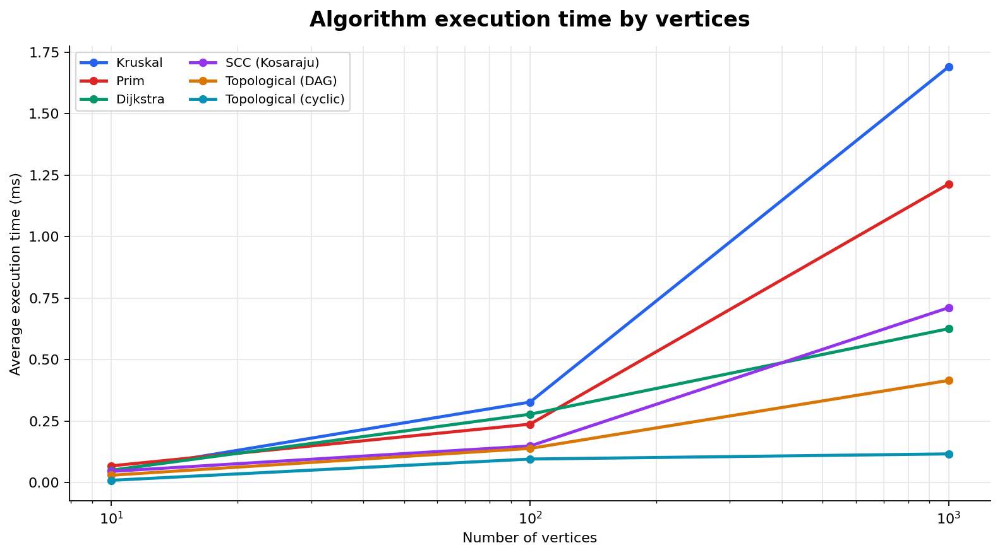
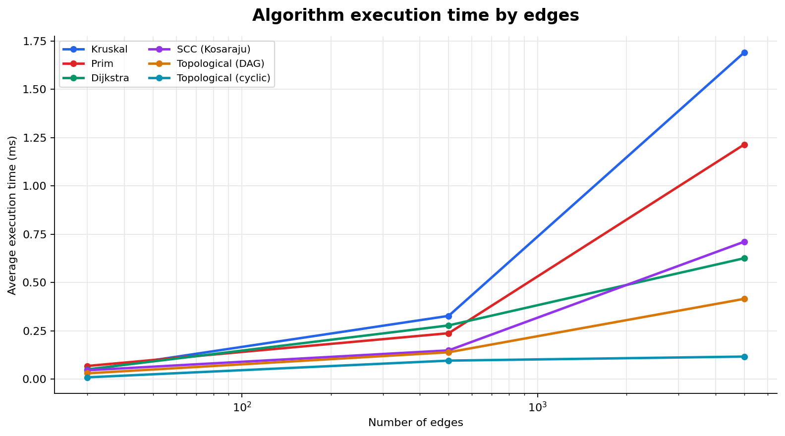

# Smart City Infrastructure and Route Planning


<p align="center">
  A Java application for city infrastructure planning, connectivity analysis, and route planning.
</p>

## Overview

This project models a city's infrastructure as a weighted graph. Vertices represent districts or locations; edges represent roads or infrastructure links; and edge weights represent construction costs or travel distances.

The application implements graph algorithms for minimum-cost connections, directed network analysis, and shortest routes. The graph uses adjacency lists and also stores an edge list for algorithms that process all roads.

## Implementation

| Component | Description |
|---|---|
| `WeightedGraph` | Stores directed or undirected weighted graphs using adjacency lists and an edge list. |
| `DisjointSetUnion` | Uses path compression and union by size for efficient component operations. |
| Kruskal | Sorts edges by weight and uses DSU to build a minimum spanning tree or forest. |
| Prim | Builds a minimum spanning tree or forest with a priority queue. |
| Topological Sort | Uses Kahn's algorithm to order DAG vertices and detect cycles. |
| Strongly Connected Components | Uses Kosaraju's two-pass depth-first search. |
| Dijkstra | Finds shortest distances and paths from a source with non-negative edge weights. |
| Benchmark tools | Generate seeded graphs, measure algorithm time and operation counts, write a CSV file, and create SVG charts. |

Dijkstra rejects negative edge weights. With negative edges, a vertex's distance could improve after the algorithm has treated that vertex as finalized.

## Complexity Analysis

Let `V` be the number of vertices and `E` the number of edges. This analysis assumes adjacency lists and a binary heap for priority queues. Prim and Dijkstra use lazy heap entries.

| Algorithm or operation | Time complexity | Additional space |
|---|---:|---:|
| DSU `find` and `union` | Amortized `O(α(V))` per operation | `O(V)` |
| Kruskal | `O(E log E + E α(V))` | `O(V + E)` |
| Prim | `O(E log E)`; for simple graphs, `O(E log V)` | `O(V + E)` |
| Kosaraju SCC | `O(V + E)` | `O(V + E)` |
| Kahn topological sort | `O(V + E)` | `O(V + E)` |
| Dijkstra | `O((V + E) log V)` for a simple graph | `O(V + E)` |

The inverse Ackermann function `α(V)` grows so slowly that DSU operations are effectively constant time in practical cases. Kruskal is mainly affected by edge sorting. Prim and Dijkstra incur priority-queue operations. SCC and topological sorting scan vertices and edges linearly.


## Experimental Setup

The experiments use the assignment's three graph sizes:

| Size | Vertices (`V`) | Edges (`E`) |
|---|---:|---:|
| Small | 10 | 30 |
| Medium | 100 | 500 |
| Large | 1,000 | 5,000 |

Graph generation is reproducible. The base seed is `20261015`; the generator uses fixed per-graph offsets based on the vertex count.

- **MST and Dijkstra graphs:** connected undirected graphs. A chain is added first to guarantee connectivity, then unique random roads are added until the requested edge count is reached. Road weights are between 1 and 10,000. Dijkstra uses source vertex 0.
- **DAG graphs:** a chain is added first, and each additional edge goes from a lower-numbered vertex to a higher-numbered vertex. This construction cannot create a cycle.
- **Cyclic directed graphs:** a chain plus a back edge guarantees a cycle. Additional edges are generated without introducing edges into vertex 0.
- **SCC graphs:** a directed ring plus unique random directed edges guarantees strong connectivity.

Each graph is created before timing begins. Every algorithm has 10 warm-up runs followed by five measured runs. Each measured run uses `System.nanoTime()`; the CSV reports the arithmetic mean. Operation counts are recorded alongside the timings. Because this is a microbenchmark, absolute times depend on the machine, Java runtime, and system load.

## Sample Run

The demo graph produced the following output:

```text
Smart City Infrastructure — sample run
Kruskal MST: weight=11, connected=true
Prim MST:    weight=11, connected=true
Dijkstra distances from district 0: [0, 3, 2, 8, 11]
Path 0 -> 4: [0, 2, 1, 3, 4]
Run ./run.sh benchmark to create measurements and plots.
```

## Results

### Average execution time

The following values are the actual results from a benchmark run with OpenJDK 17.0.20 on Linux. Times are milliseconds, rounded to three decimal places. The complete nanosecond measurements and operation counts are in `results/tables/benchmark-results.csv`.

| Algorithm | 10 vertices / 30 edges | 100 vertices / 500 edges | 1,000 vertices / 5,000 edges |
|---|---:|---:|---:|
| Kruskal | 0.047 ms | 0.327 ms | 1.690 ms |
| Prim | 0.068 ms | 0.238 ms | 1.214 ms |
| Dijkstra | 0.050 ms | 0.278 ms | 0.626 ms |
| SCC (Kosaraju) | 0.046 ms | 0.149 ms | 0.711 ms |
| Topological sort (DAG) | 0.030 ms | 0.139 ms | 0.415 ms |
| Topological sort (cyclic graph) | 0.009 ms | 0.096 ms | 0.117 ms |

### Operation counts for the largest graphs

| Algorithm | Edge examinations | Comparisons | DSU finds | DSU unions | Heap polls | Heap offers | Relaxations |
|---|---:|---:|---:|---:|---:|---:|---:|
| Kruskal | 3,665 | 55,188 | 7,330 | 3,665 | — | — | — |
| Prim | 10,000 | — | — | — | 5,000 | 5,000 | — |
| Dijkstra | 10,000 | — | — | — | 1,996 | 1,996 | 1,995 |
| SCC (Kosaraju) | 10,000 | — | — | — | — | — | — |
| Topological sort (DAG) | 10,000 | — | — | — | — | — | — |
| Topological sort (cyclic graph) | 5,009 | — | — | — | — | — | — |

### Execution time vs. number of vertices



### Execution time vs. number of edges



The charts use a logarithmic horizontal axis so the small, medium, and large graph sizes can be compared in one view.

## Testing

All **24 checks passed**. The test program covers:

- Single-vertex and disconnected graphs
- Minimum spanning forests and connectivity reporting
- Equal edge weights and graphs with multiple valid MSTs
- Agreement between Kruskal and Prim
- Valid topological ordering of a DAG and cycle detection
- Strongly connected components and assignment of every vertex to one component
- Dijkstra distances, reconstructed paths, unreachable vertices, and negative-edge rejection
- Generated connected, DAG, and cyclic graphs at all three required sizes

<details>
<summary>View the complete test output</summary>

```text
PASS: Kruskal handles one vertex
PASS: Prim handles one vertex
PASS: Disconnected graph is reported
PASS: Disconnected input returns a minimum spanning forest
PASS: Equal-weight graph is connected
PASS: Kruskal and Prim agree when multiple MSTs exist
PASS: DAG receives a full topological ordering
PASS: Returned ordering respects every edge
PASS: Directed cycle prevents topological ordering
PASS: Kosaraju identifies all SCCs
PASS: Every vertex belongs to one SCC
PASS: Dijkstra returns the shortest distance
PASS: Dijkstra reconstructs the shortest path
PASS: Unreachable vertex is represented explicitly
PASS: Dijkstra rejects negative edge weights
PASS: Generated MST instance agrees at V=10
PASS: Generated DAG is acyclic at V=10
PASS: Generated cyclic graph is detected at V=10
PASS: Generated MST instance agrees at V=100
PASS: Generated DAG is acyclic at V=100
PASS: Generated cyclic graph is detected at V=100
PASS: Generated MST instance agrees at V=1000
PASS: Generated DAG is acyclic at V=1000
PASS: Generated cyclic graph is detected at V=1000
All 24 checks passed.
```

</details>

## Comparison and Discussion

Kruskal and Prim returned the same MST weight on all three connected undirected benchmark graphs, satisfying the correctness check. On the largest graph in this run, Prim took about 1.214 ms and Kruskal about 1.690 ms. Kruskal sorted the input edge list, while Prim processed edges through a priority queue; this run favored Prim for the largest graph. The difference is specific to this implementation and environment.

Dijkstra's measured time increased with graph size, as more adjacency entries and priority-queue operations were processed. Kosaraju and DAG topological sorting also grew with the graph, consistent with their `O(V + E)` complexity. The cyclic topological run stopped after processing only the acyclic prefix, so it examined fewer edges and completed faster than the full DAG run.

At 1,000 vertices and 5,000 edges, Kruskal's comparator ran 55,188 times; DSU recorded 7,330 find calls and 3,665 union calls. Prim and Dijkstra each examined 10,000 adjacency entries because an undirected edge appears in the adjacency lists of both endpoints. Dijkstra made 1,995 successful relaxations. These operation counts help explain the measurements and are more stable than small timing differences.

## Conclusion

Kruskal is suitable when processing edges in sorted order is convenient, while Prim builds a network outward from a starting district. DSU makes Kruskal's component checks efficient. Kosaraju identifies groups of mutually reachable locations, and topological sorting orders acyclic dependencies while detecting cycles. Dijkstra is appropriate for route planning when all travel costs are non-negative.

The tests passed, and the benchmark produced the required CSV table and two plots. The measurements are reproducible with the fixed graph-generation seeds, though execution times may vary across machines.
